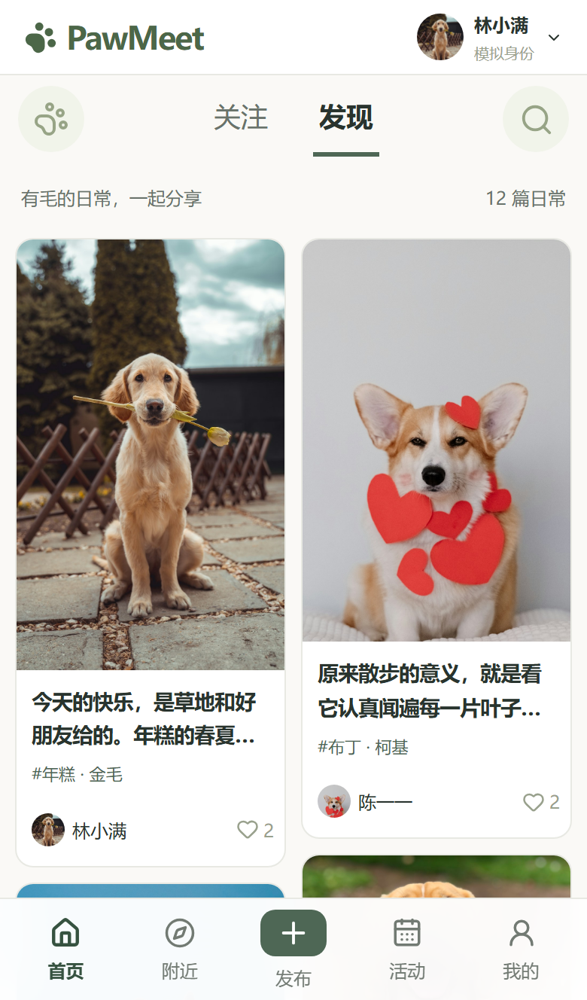
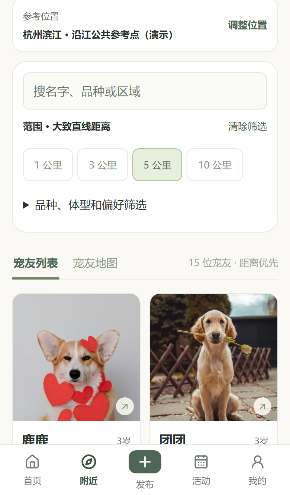
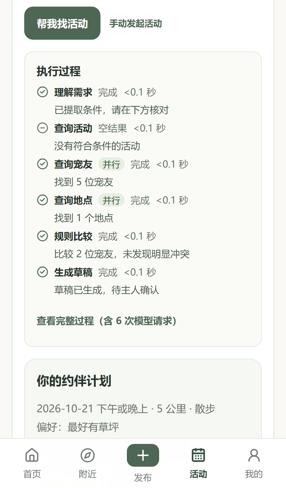
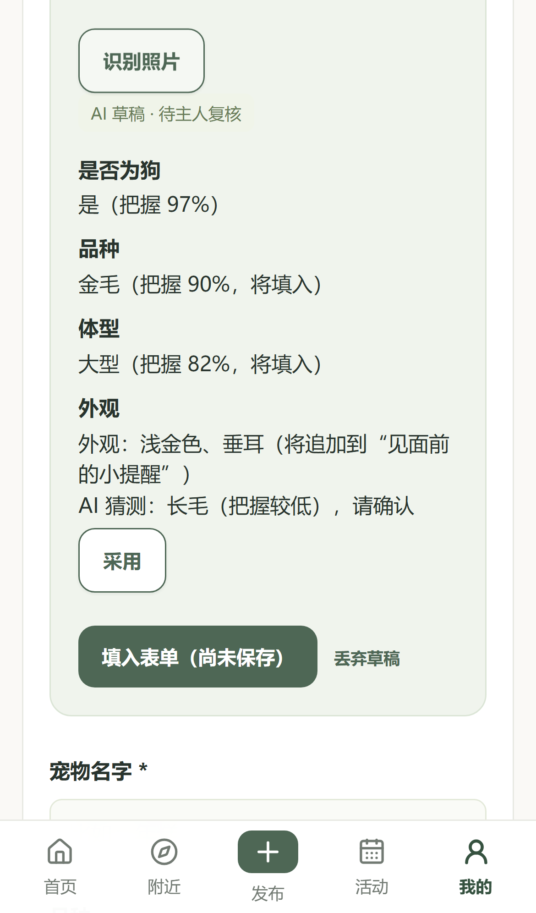
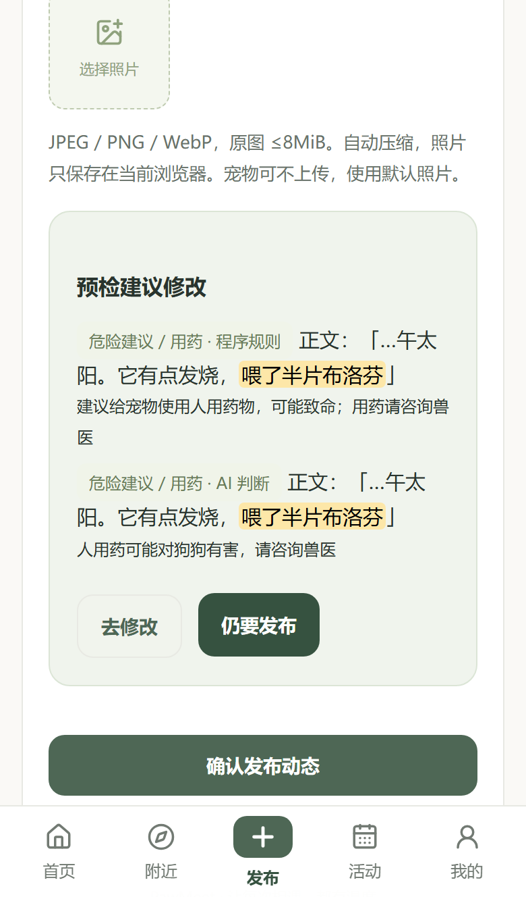
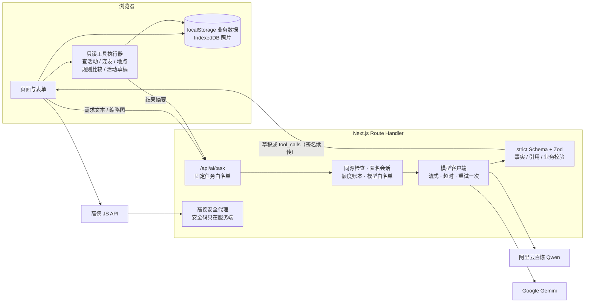

# PawMeet

**遇见同频的毛孩子。** 一个移动端优先的宠物社交与临时互助 Web Demo：分享日常、找附近宠友、约伴遛狗、临时帮忙照看。项目重点是把大模型接进真实业务流程：模型只生成草稿和查询参数，程序负责校验，主人确认后才写入数据。

技术栈：Next.js（App Router）· React · TypeScript strict · Tailwind · Zod · Qwen / Gemini（OpenAI 兼容接口）· 高德地图 JS API · Vitest · Playwright

## 核心亮点

- **AI 智能约伴：原生多工具调用循环。** 用一句话描述需求（“周六下午 5 公里内散步，最好有草坪”），模型先调用工具查询已有活动；没有合适的就并行查宠友和地点，再做规则比较，最后生成活动草稿。工具在浏览器里只读执行，每一步都显示在“执行过程”时间线上。
- **拍照建档：视觉识别 + 程序交叉校验。** 点击“识别照片”后，只把压缩到 512px、去掉 EXIF 的缩略图发给视觉模型。识别结果先经过 Schema 和业务审核：低置信度字段要主人点“采用”才填入；体型和程序维护的品种体型表冲突时，以表为准。
- **社区 AI：标题标签草稿 + 两层发布前预检。** 一键生成标题和话题标签草稿。发布前先跑浏览器端的程序规则（手机号、微信号这类个人信息直接拦截），再由模型做语义判断。AI 失败时只显示“AI 预检未执行”，不会显示成“已通过”。
- **结构化输出 + Zod 业务校验 + 多模型真实评测。** 所有输出都经过 strict JSON Schema 和共享 Zod 校验，再过事实、引用和业务规则检查。同一套 41 条程序判定用例在 Qwen 和 Gemini 的 4 个模型上真实跑过，每个模型有 Token 上限，失败也如实记录。

## 界面截图

> 界面截图（手机宽度，生产构建）。AI 结果为演示数据（固定的 mock 响应），照片来自项目自带的演示素材。

| 首页 | 附近宠友 | 约伴执行过程 |
| --- | --- | --- |
|  |  |  |

| 拍照建档草稿 | 发布前预检 |
| --- | --- |
|  |  |

## 架构



- 没有服务端业务数据库：业务数据在浏览器本地，服务端只做模型调用、限额和地图代理。工具在浏览器执行，只回传必要的摘要，不上传完整 localStorage、照片原图或住址。
- 模型只能从服务端白名单中选择（文本 `AI_MODEL`、视觉 `AI_VISION_MODEL`），浏览器不能指定模型，也不会自动回退到其他模型。
- 详细契约见 [ARCHITECTURE](docs/ARCHITECTURE.md)，关键取舍见 [DECISIONS](docs/DECISIONS.md)。

## AI 设计要点

1. **AI 只出草稿。** 模型返回的内容只用于填表单或生成查询参数，并带“AI 填入”标记，手改后标记消失。主人点确认后，才走正式的业务命令、Schema 和角色 / 状态校验。模型不产生宠友、地点、距离、安全结论或诊断。
2. **不信任模型输出。** strict Schema 只保证格式，所以另有程序校验：排斥条件不能被展开成白名单，工具参数由程序用已确认的条件覆盖，最终回答只能引用本次工具真实返回的行。工具调用有轮数和次数上限。
3. **置信度没校准，就交给程序规则。** 视觉评测里两次失败都是“自信地错了”：品种认对（0.95），体型却错一档（0.85）。因此加入了程序维护的品种体型表做交叉校验（[D026](docs/DECISIONS.md)）。社区预检同理：个人信息由确定性规则拦截，模型判断只作建议（[D025](docs/DECISIONS.md)）。
4. **评测里发现、已修复的问题：**
   - 模型没有调用工具，却回答“已查询，没有结果”。修复后，没有工具结果的一轮只接受澄清类回答。
   - Gemini 遇到工具报错后反复调用同一工具。修复后，工具出错的下一轮不再提供工具，强制如实收尾。
   - 接 Gemini 时的两处兼容问题：流式 tool_calls 不带 `index`；回答修复指令用 system 角色时，Gemini 返回 HTTP 400。

开发过程中具体的例子和对应提交见 [AI_CODING](docs/AI_CODING.md)。

## 评测结果（真实调用）

所有检查都由程序判定，不用 LLM 当裁判。下面只列真实调用结果，不包含任何模拟数据。方法、原始报告和失败明细见 [AI_EVAL](docs/AI_EVAL.md)。

**文本：智能约伴、档案填写、互助填表**（41 条用例 × 2 轮 = 82 次尝试，每个模型 ≤30 万 Token）

| 模型 | 已执行 / 计划 | 通过率（网络失败计入） | 只看有响应的尝试 | 总时长 p50 |
| --- | --- | --- | --- | --- |
| gemini-3.8-flash | 82 / 82 | 87.8% | 72 / 82 | 2.7 s |
| gemini-3.5-flash-lite | 82 / 82 | 86.6% | 71 / 82 | 1.6 s |
| qwen3.8-max-0902 | 61 / 82（额度耗尽） | 91.8% | 56 / 56 | 10.1 s |
| qwen3.8-flash | 36 / 82（额度耗尽） | 63.9% | 23 / 28 | 9.7 s |

结论：qwen3.8-max-0902 在有响应的尝试里全部通过；两个 Gemini 跑满全部尝试，失败集中在两类：工具出错后不收尾（被 4 轮上限拦下），以及不严格执行 Schema 枚举（被业务校验拦下）。没有错误数据被写入。局限：评测在海外网络下进行，到百炼北京端点的跨境连接经常失败或超时，Qwen 的延迟主要反映网络。超时请求按整笔预留计入额度，所以两个 Qwen 模型没能跑完，qwen3.8-flash 的样本不足以下结论。上面提到的“出错后强制收尾”修复，还没有用真实调用复测。

**视觉：拍照建档**（16 张带标签的授权图片：常规小 / 中 / 大型各 4 张、难例 2 张、非狗 2 张）

| 模型 | 通过 | 总时长 p50 | 失败 |
| --- | --- | --- | --- |
| gemini-3.5-flash-lite | 15 / 16 | 1.7 s | 比格判成小型 |
| gemini-3.8-flash | 15 / 16 | 2.9 s | 萨摩耶判成中型 |
| qwen3.8-omni-flash / qwen3.5-omni-plus | 未完成 | — | 跨境连接百炼北京端点失败 / 超时 |

结论：32 次输出全部符合 Schema，没有给出健康或性格判断。猫、毛绒玩具狗、两只狗同框、只拍到狗鼻子，都正确地没有填写。用两次运行保存的原始输出离线复算加入品种体型表后的规则：lite 自动填入的错误从 1 个降到 0；3.8-flash 仍是 1 个，因为萨摩耶在表中允许中型和大型。局限：只有 16 张图；Qwen-Omni 没有可比结果，这不代表它的识别能力。

**社区 AI：冒烟**（9 条标题标签 + 10 条发布前预检，两个模型共用 5 万 Token）

| 模型 | 通过 | 标题标签 / 预检 p50 |
| --- | --- | --- |
| gemini-3.5-flash-lite | 19 / 19 | 1.5 s / 1.5 s |
| gemini-3.8-flash | 19 / 19 | 2.1 s / 2.2 s |

结论：冒烟全部通过。程序规则层漏掉了两条词表外的虐待说法（“饿它三天”“老鼠药拌在肉里”），模型层都判了出来；用例里的提示注入，两个模型都没有照做。局限：样本小，检查是关键词和结构规则，不评估标题质量；冒烟通过不等于准确率。

## 本地运行

需要 Node.js 24.x 和 npm。

```bash
npm ci
```

```bash
npm run dev
```

打开 <http://localhost:3000>。不配置任何密钥，社区、附近（距离筛选与列表）、活动、互助等人工流程都能完整使用；AI 和在线地图未配置时会显示明确的错误，不会伪装成功。

要启用 AI 或地图，复制 `.env.example` 为 `.env.local` 并按需填写（密钥只在服务端使用，不要提交）：

| 变量 | 作用 |
| --- | --- |
| `AI_ENABLED` | 设为 `true` 才会调用模型，默认关闭 |
| `AI_MODEL` / `AI_VISION_MODEL` | 文本 / 视觉模型，必须在白名单内；代码默认 `qwen3.8-flash` / `qwen3.8-omni-flash` |
| `DASHSCOPE_API_KEY` / `AI_BASE_URL` | 阿里云百炼的密钥与兼容端点（使用 Qwen 时需要） |
| `GEMINI_API_KEY` | Google AI Studio 密钥（使用 `gemini-*` 模型时需要） |
| `AI_STREAM`、`AI_FIRST_BYTE_TIMEOUT_MS`、`AI_TOTAL_TIMEOUT_MS` | 流式开关、首字节超时与单次总超时 |
| `AI_MAX_DAILY_CALLS`、`AI_MAX_DAILY_TOKENS`、`QUOTA_STORE_PATH` | 每日调用 / Token 上限，以及本地额度账本的位置 |
| `DEMO_SESSION_SECRET` | 匿名会话签名密钥（可选） |
| `APP_ORIGIN` | 浏览器访问源，例如 `http://localhost:3000`，必须与实际地址一致 |
| `NEXT_PUBLIC_AMAP_JS_KEY` / `AMAP_SECURITY_JSCODE` | 高德 Web 端（JS API）Key 与安全密钥（可选）；安全密钥只经服务端代理使用 |

在海外网络下运行时，建议设 `AI_MODEL=gemini-3.5-flash-lite`、`AI_VISION_MODEL=gemini-3.5-flash-lite`，并配置 `GEMINI_API_KEY`：速度最快，效果与 gemini-3.8-flash 相当。在国内网络下可用默认的 Qwen。高德需要在[高德控制台](https://console.amap.com/)创建“Web端（JS API）”Key，并限制来源域名。修改配置后要重启服务，生产模式还要重新 build。浏览器地址必须与 `APP_ORIGIN` 完全一致（`localhost` 和 `127.0.0.1` 算不同的源）。同一浏览器同时只有一个标签页可以编辑，其他标签页只读。

生产模式：

```bash
npm run build
```

```bash
npm run start
```

测试（Playwright 使用生产构建并自动启动服务；AI 和地图全部是 mock，不调用真实模型）：

```bash
npm run lint
```

```bash
npm run typecheck
```

```bash
npm run test
```

```bash
npx playwright install chromium
```

```bash
npm run test:e2e
```

当前结果：Vitest 485 项、Playwright 120 项（桌面 + 手机）通过。真实模型评测需要显式开启并设置 Token 上限，命令见 [AI_EVAL 复现](docs/AI_EVAL.md#复现)。

## 目录结构

```text
src/app/            页面路由；api/ai/[task] 是 AI 接口，%5FAMapService 是高德安全代理
src/features/       业务界面：社区、附近、活动、互助、档案、AI（约伴 / 拍照 / 时间线）
src/domain/         纯数据模型与规则：Zod Schema、业务命令、距离、匹配、发布预检
src/lib/ai/         前后端共享的 AI 契约、校验、只读工具、同义词表、品种体型表
src/server/ai/      仅服务端：模型白名单、客户端（流式 / 重试）、Prompt、额度
src/lib/storage/    localStorage 仓库与 IndexedDB 照片
evals/              评测用例、多模型 runner、分模型额度、真实与模拟报告
tests/              Vitest 单测与 Playwright 端到端测试
docs/               需求、架构、决策、评测与 AI Coding 说明
```

## 演示边界

- 数据只保存在当前浏览器，刷新后保留；换浏览器就是独立的一份。可以在“我的”里一键重置。
- 5 个可切换的模拟身份，切换不是登录。25 个宠物档案、坐标和互动都是虚构的。
- 没有真实注册登录、聊天、支付或寄养交易；普通地点的“宠物能否进入”一律显示未知。
- 未部署线上环境，按上文在本地运行。

## 用 AI Coding 开发

这个项目整体用 AI Coding 工具开发：[AGENTS.md](AGENTS.md) 写长期规则，本地交接与进度文档负责跨会话衔接，每一步在独立会话中按“读文档 → 小任务 → 看差异 → 跑测试 → 写证据 → 提交”推进。测试兜住 AI 生成代码的例子见 [docs/AI_CODING.md](docs/AI_CODING.md)。

文档：[产品需求](docs/PRD.md) · [架构](docs/ARCHITECTURE.md) · [技术决策](docs/DECISIONS.md) · [AI 评测](docs/AI_EVAL.md) · [AI Coding](docs/AI_CODING.md) · 演示照片[来源与许可](public/images/SOURCES.md)
