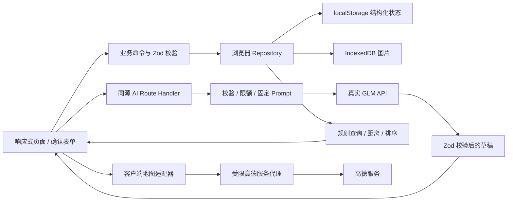

# PawMeet 技术架构

状态：2026-10-17。Phase 1–3 本地业务与地图保留；Phase 4 已实现 GLM 服务、结构化草稿、规则推荐和原生工具调用循环。真实模型仍存在额度 / 超时和输出错误，不能标为阶段完成；证据见 [AI_EVAL](AI_EVAL.md) 与 [PROGRESS](PROGRESS.md)。Phase 5 未授权。

## 1. 选型与边界

| 层 | 决策 | 理由 |
| --- | --- | --- |
| 应用 | Next.js App Router + React + TypeScript strict | 单应用承担页面与受保护服务端接口，无独立后端工程 |
| UI | Tailwind CSS、按需 shadcn/ui / Radix、Lucide | 快速形成可访问的移动端抽屉与桌面布局，不整套引入重型组件库 |
| 状态 | React Context 发布已持久化快照，纯业务命令 + Repository | 写入成功才更新状态；不在 reducer 中执行存储副作用，不先引入全局状态库 |
| 校验 | Zod 4，表单、持久化、API 契约共享定义 | 类型来源统一；AI 草稿 Schema 与正式业务 Schema 分离 |
| 数据 | localStorage JSON + 图片 IndexedDB + 项目静态资源 | 不使用云数据库；每浏览器独立 |
| 地图 | 高德 JS API 2.0，官方 script 方式按需加载 | 单例加载与服务适配器隔离，安全码仅服务端 |
| AI | 服务端原生 fetch 调用智谱普通 API | 少依赖；按任务设置 Prompt、Schema、token 上限 |
| 测试 | Vitest、Testing Library（必要组件）、Playwright | 规则 / 存储 / 接口 / 关键用户路径分层验证 |
| 工具 | npm + package-lock、ESLint CLI、Git | 不混用包管理器；build 不替代 lint |

当前运行环境 Node 24.15.0 / npm 11.12.1；Next 16.4.2、React 19.3.1、Zod 4.6.7、Tailwind 4.3.3 已安装并锁定，其他精确版本见 [package.json](../package.json) 和 lockfile。已通过生产构建与 Chromium 流程测试，不代表其他设备和国内网络均通过。没有使用 canary 或外部字体 CDN。



SSR 只输出公共页面壳与稳定骨架。浏览器 `DemoProvider` 挂载后读取 / 校验状态再显示个人数据，避免 hydration mismatch；服务端组件、API Route 无法读取 localStorage。业务新增 / 修改不发送服务端持久化接口。状态中的身份仅用于演示逻辑，不作为服务端鉴权或额度依据。

## 2. 实现目录与扩展边界

当前核心路径：

```text
src/app/                         # 五栏、动态 / 活动 / 宠物详情及创建编辑路由
src/components/{shell,ui}.tsx     # 响应式壳、Dialog、图片及公共 UI
src/features/demo/provider.tsx   # 挂载读取、单标签锁、快照发布、恢复 / 重置
src/features/{pets,community,activities,discover,help,cards,me,forms}/
src/domain/{schemas,commands,phase2,social}.ts # Zod、状态机、角色与确定性偏好规则
src/domain/legacy-schema.ts      # 冻结的 Phase 1 v1 校验器，仅用于迁移
src/data/seed.ts                 # 固定种子 ID、相对时间与公共演示地点
src/lib/storage/                # repository 与 IndexedDB 图片适配器
src/lib/{ai,maps}/contracts.ts   # 共享输入输出与工具结果 Schema
src/domain/{geo,discover}.ts     # GCJ02 Haversine 与唯一宠友查询
src/features/maps/              # MapCanvas、PlaceExplorer / PlacePicker、地点详情
src/lib/maps/{client,proxy,navigation}.ts # SDK 服务、代理校验、导航 URI
src/app/api/maps/config/route.ts # 只返回公开 JS Key，配置缺失 503
src/app/%5FAMapService/[...path]/route.ts # 对外 URL /_AMapService
src/server/maps/{http,quota}.ts  # 固定 HTTPS 上游、持久限额；server-only
public/images/                  # 本地照片、占位图、来源许可
tests/{unit,e2e,live}/           # 规则 / 存储 / SDK mock 与显式真实地图检查
```

Phase 4 实现入口：

```text
src/app/api/ai/[task]/route.ts     # 固定任务白名单，无通用聊天透传
src/domain/matching.ts            # 可解释偏好匹配分与比较依据
src/lib/ai/                       # 客户端、Schema、语义校验、只读工具执行器
src/server/ai/                    # server-only GLM client、prompts、validators
tests/unit/ai*.test.ts            # GLM mock、工具协议、限额与规则
evals/{cases,runner,reports}/      # 35核心+11对抗+8工具；分开报告live/mock
```

当前业务组件通过 Provider 的 `run` 调用纯命令和 Repository；`PetImage` 管理上传图 object URL 的创建 / 回收，原生 dialog 提供焦点与 Esc 关闭，表单包含未保存提醒。名片、两宠比较和 PNG 导出位于 `features/cards`；地点选择器位于 `features/maps`，嵌入表单并只更新内存草稿；筛选使用可折叠区域。AI 草稿复核位于 features/ai/draft.tsx，助手位于 /assistant。地图适配器不含业务排序逻辑；AI 组件不能直接写 Repository。

## 3. 数据契约

通用：ID 为带前缀稳定种子 ID 或 `crypto.randomUUID()`；时间以 UTC ISO 字符串保存、按 Asia/Shanghai 展示；月龄为非负整数而非浮点岁数。每个实体有 id、createdAt、updatedAt、revision；种子角色均虚构。Zod 使用 strict 对象、有限数组与文本长度，拒绝额外字段。名片和清单只接受 `manual`，地点接受 `demo/amap/manual`；AI 草稿仅在内存，用户编辑并确认后保存为主人复核内容；现有 source=manual 代表最终人工确认，暂不单独持久化模型溯源。

| 实体 | 核心字段与约束 |
| --- | --- |
| DemoUser | displayName、avatar ImageRef、isSwitchable；共 25 条，5 条可切换 |
| Pet | ownerId、species=`dog`、name(1–20)、breed(1–30，可“未知”)、ageMonths(null 或 0–360)、size=`small/medium/large/unknown`、city、district、photo ImageRef、temperamentTags、activityTags、socialNotes(≤500)、demoLocation、isFictional=true |
| SocialCard | petId、petRevision、traits / likes / dislikes / cautions（各 ≤6 项、单项 ≤60 字）、meetingAdvice(≤300 字)、source=`manual`、confirmedAt、confirmedBy；空数组表示未知，不能当作没有风险 |
| Post | authorId、petIds(≤3)、text(1–1000)、images(≤3)、likedByUserIds（去重 ID） |
| Activity | organizerId、organizerPetId、recommendedPetIds(≤5，仅推荐)、title(1–40)、description(≤500)、place PlaceRef、startAt、endAt、capacity(2–12)、status=`scheduled/cancelled` |
| ActivitySignup | activityId、userId、petId、status=`joined/cancelled`；每活动每身份最多一个 joined；组织者自动 joined |
| HelpRequest | requesterId、petId、type=`walk/feed`、title、details(≤1000)、startAt、endAt、place、status=`open/assigned/helper_done/completed/cancelled`、helperId?、acceptedApplicationId?、contentRevision（仅核心内容修改递增） |
| HelpApplication | helpId、applicantId、message(≤200)、status=`pending/accepted/rejected/withdrawn`；同人同需求最多一个有效申请 |
| HelpEvent | helpId、actorId、action、fromState、toState、createdAt；状态变化与记录一次写入 |
| CareChecklist | helpId、petRevision、requestRevision、items（≤12 个 title/detail/needsConfirmation）、source=`manual`、confirmedBy、confirmedAt；requestRevision 引用需求 contentRevision，档案或需求内容变更要求重新确认 |
| ReferenceLocation（页面状态） | lng、lat、crs=`GCJ02`，另保存可见来源标签；不进入持久化信封，与宠物展示位置独立 |
| PlaceRef | source=`amap/manual/demo` 判别联合；name(≤60)、district(≤30)、address?(≤200)、location GCJ02（经度±180、纬度±90）；仅 manual 可为 null，仅 amap 可有 poiId；petAccess 固定 unknown |
| ImageRef | 判别联合：`{kind:static,path}` 或 `{kind:upload,imageId}`；不存 base64 或任意远程 URL |

正式 Pet 至少名称、照片（可选项目占位图）、品种 / 未知、体型 / 未知、城市区域和公共演示位置有效。年龄未知可 null，不阻碍保存。性格 / 活动数组各 ≤8 个，受控标签加说明字段；常用标签词典在 Phase 1 定稿并供 Prompt 引用。活动 / 互助发布须有确定的未来起止时间、地点、本人宠物；`endAt > startAt`，时间边界按同一 clock 计算，不能把未知值自动补成事实。

当前存储 key 保留 `pawmeet:state:v1`，信封 `schemaVersion=2`：schemaVersion、seedVersion、revision、seededAt、activeUserId、users、pets、socialCards、posts、activities、activitySignups、helpRequests、helpApplications、helpEvents、careChecklists、settings。草稿与 UI 状态默认内存保存；用户确认后的业务对象才进入信封。可保存明确“手工草稿”，但不得当作发布记录。

Phase 3 对 v2 的 PlaceRef 作兼容扩展，不重写已有 demo 地点或档案坐标。新浏览器 / 用户明确重置才获得调整后的 25 个演示区域点；没有自动迁移用户位置。旧 v1 仍用冻结 Schema 校验后纯迁移到 v2；旧版应用不承诺理解新增来源，因此不要回退旧应用继续写新数据。

引用完整性：宠物必须引用存在主人；报名引用存在活动和该身份拥有的宠物，组织者必须占一个名额，报名和点赞去重。档案删除使用 `archivedAt` 归档，不物理删除，历史动态引用保留；有未结束活动、未来开放互助或 assigned / helper_done 互助引用时阻止删除。归档宠物不出现在发现和选择器，不能再编辑 / 新报名。帖子无删除入口。名片仅主人可确认且 petRevision 必须当前；清单仅求助人可编辑，引用当前宠物版本与需求 contentRevision。实体引用、有效申请唯一性、已选帮助者 / acceptedApplicationId 一致性由 Schema 校验；具体操作的角色与状态在命令层校验。

### Phase 2 命令、查询与分享

- [phase2.ts](../src/domain/phase2.ts) 统一处理 `save-card`、`save-help`、`apply-help`、`withdraw-help`、`assign-help`、`helper-done`、`complete-help`、`cancel-help`、`save-checklist`；Provider 仍只发布持久化成功的新快照。
- 互助状态与权限遵循 [PRD](PRD.md#互助状态机与权限)。选择帮助者前必须有主人确认的当前版本清单；清单可显式保留细节待确认，不补全未知事实。帮助者标记完成时也复核清单版本。选择与双方完成重试不重复产生事件；重复申请明确拒绝。
- 申请 / 撤回 / 清单保存只修改独立实体和事件；状态迁移更新任务 revision。需求编辑另递增 contentRevision，因此选帮助者等状态变化不会误使交接内容失效。仅 open、未来且无有效申请可编辑核心字段；清单只允许 open / assigned 编辑。所有写入受整个信封上限和 2MiB 预算约束。
- [social.ts](../src/domain/social.ts) 仅对有效名片 likes / dislikes 的六个完整词条，以及档案“喜欢追逐 / 怕追逐”做双向冲突判断。自由文字保留展示，不做否定句、同义词或隐含风险推断。未识别冲突不等于适合互动；不输出行为诊断、安全结论或评分。名片引用失效时不参与规则并禁止导出。
- [export.ts](../src/features/cards/export.ts) 用本地 canvas 排版生成 PNG，按内容行数决定高度；照片来源仅本地静态图或 IndexedDB。支持 `canShare` 时分享 PNG 文件，否则下载；不生成跨设备本地 ID 分享链接。
- 档案 / 宠友卡进入名片比较；档案或比较页进入 `/activities/new?recommendedPetId=…`，保存推荐宠物引用，公共地点为待主人确认的默认演示建议，绝不表示邀请已发送 / 对方已同意。
- [AI contracts](../src/lib/ai/contracts.ts) 定义任务输入输出、工具调用与有界结果Schema；正式保存仍经过共享 Schema 和命令。统一任务和原生 Tool Calling 已接入；真实结果与 mock 证据分列 AI_EVAL。

## 4. 浏览器存储与恢复

1. 首次挂载：读取信封 → 版本检查与 Zod / 引用校验 → 无数据才初始化种子。v1 先由冻结的旧 Schema 严格校验，纯迁移到 v2，给互助补 null 帮助者引用及 contentRevision=1；只读加载不写原文，下次持有写锁的命令才原子保存 v2。旧版种子预览文案仅在完整匹配时更新为演示说明，用户内容保持。未知版本 / 旧数据损坏不覆盖。
2. 命令执行：从最新 revision 校验身份 / 状态 → 生成整个新快照 → 序列化与大小预检 → 单 key `setItem` 成功后更新内存并显示成功。QuotaExceeded / SecurityError 则保留原状态和表单，提示清理图片或重试。
3. 结构化数据保守预算 2MiB（按 UTF-16 估算，不承诺浏览器统一配额）；帖子上限 100、活动 / 互助各 100，达到上限提示重置 / 清理，不静默删除历史。读取损坏时保留原始数据，提供导出原文 / 确认重置，不自动重建覆盖。
4. 上传仅 JPEG / PNG / WebP，单原图 ≤8MiB，解码检查且拒绝超过 5000 万像素；最长边 ≤1280，Canvas 输出 WebP（不支持时浏览器可能返回 PNG），通过质量梯度控制为 ≤250KiB，超出则拒绝。每帖 ≤3 张、全局 ≤30 张且 ≤10MiB；全局检查和插入在同一个 IndexedDB readwrite 事务完成。先写 Blob 再提交 ImageRef；图片失败不产生引用。业务提交失败保留表单与已上传照片以便重试，取消 / 离开表单时清理本次临时图；异常退出的孤儿可在“我的”清理。缺图显示占位，宠物主人可编辑替换。图片不入 localStorage、不送模型；刷新重新生成并回收 object URL。
5. reset：确认 → 准备新种子 → 写入新信封 → 清理旧上传图。清理失败报告可重试，但不得继续引用已删图。种子静态图无需删除。
6. 同一源只支持一个可写标签页，Web Locks 持有写锁；第二标签页显示提示并只读。无 Web Locks 或获锁失败时同样关闭写入，不使用不能提供原子互斥的心跳抢锁。关闭原编辑页后刷新可接管。Repository 每次提交复读并比较完整快照 / revision，拒绝被外部更改的旧状态。storage 事件发现外部变更后禁用当前页写入并提示刷新，不做实时同步。浏览器必须在可信上下文使用相关能力；不能保证恶意直接改 localStorage 不破坏演示。

## 5. 规则查询与匹配

当前 [discoverQuery](../src/domain/discover.ts) 在客户端从当前快照执行：排除自己的 / 归档宠物 → 按参考位置计算距离 → 硬筛选 → 距离升序、同距按 ID 稳定排序。所有距离均为 **GCJ-02 坐标上的 Haversine 近似球面直线距离**，单位内部米，展示“大致直线距离”，不是路线距离或 GPS 测量。

- distanceKm 白名单 1/3/5/10，边界包含 `distanceM <= radiusM`，在未四舍五入值上比较；距离排序同值按 ID 稳定排序。默认 5km，参考点为滨江公共演示中心。
- 同筛选字段多选 OR，字段间 AND；当前支持品种、体型、受控性格和活动偏好，以及名称 / 品种 / 区域文字搜索。缺失标签不满足正向条件；切参考点重算全部结果。范围、数量和枚举由共享 `discoverFilterSchema` 校验，AI 只能提交查询条件，不生成宠友实体或距离。

[matching.ts](../src/domain/matching.ts) 已实现推荐扩展：
- 匹配为可解释偏好分（非安全概率）：活动标签 Jaccard ×45、已知相同性格且无已识别冲突项 ×30、体型相同项 ×15、`max(0,1-distanceM/10000)` ×10；未知项为 0 并提示信息不足，不归一化冒充完整信息。性格相容项复用明确相同标签与comparePets冲突规则，例如一方“怕追逐”而另一方“喜欢追逐”标注意事项，不推断攻击风险。
- 按匹配排序为分降序→距离升序→ID。显示对应规则贡献与已知差异，不将“同品种”默认计为合适。数字称“偏好匹配分”，不能叫安全分。
- 适配分析先运行 comparePets 与 comparisonEvidence；GLM 只能选择、排序给定依据并逐行摘录，不新增事实。解释引用和句子均校验；输出不合约时解释失败可见，原规则结果仍可使用。自由社交文字不做专业行为判断。

## 6. GLM 调用与确认机制

### 统一服务与任务

[Route](../src/app/api/ai/[task]/route.ts) → [Service](../src/server/ai/service.ts) → [Client](../src/server/ai/client.ts)。密钥、Prompt、固定模型与额度模块使用 server-only。仅允许服务端环境 GLM_API_KEY / GLM_BASE_URL / GLM_MODEL；默认 glm-4.7-flash，拒绝其他型号，不自动使用付费模型。Base URL 固定校验为 HTTPS open.bigmodel.cn/api/paas/v4，禁止客户端透传。

POST /api/ai/{task} 接受 {text, context}。固定任务为 pet-profile、social-card、match-intent、help-intent、care-checklist、social-analysis、post-copy；不接受 now、system、model、URL 或业务写入字段。服务端构造可信当前时间与 Asia/Shanghai。仅本地评测可冻结时间。

| 任务 | 最少上下文与结果 |
| --- | --- |
| pet-profile | 描述文本；基本信息可空，性格 / 活动标签附原文证据，喜欢 / 不喜 / 注意事项为原文字符串 |
| social-card | 描述 + 单只宠物必要习惯摘要；可编辑名片四块与初见建议 |
| match-intent | 描述 + 选中本人宠物摘要；包含 / 排除条件、半径、排序与澄清，不含宠友实体 |
| help-intent | 描述 + 最多3只本人宠物摘要；类型、宠物、起止、时长、原始时间文字、地区和地点线索；不生成坐标 |
| care-checklist | 单只档案习惯与本次互助内容；可编辑清单，未知饮食、健康、交接细节强制保留待确认项 |
| social-analysis | 两宠程序计算的最多20条依据；输出只能引用并摘录这些依据 |
| post-copy | 用户自己的文字；摘录整理后由用户编辑发布 |

成功 {ok:true,requestId,data,meta:{provider,model,promptVersion,schemaVersion,latencyMs,usage}}；clarifications / warnings 位于各任务 data 内。失败 {ok:false,requestId,error:{code,message,retryable}}，不返回上游原始正文或思考过程。400 输入 / 协议、413 超量、403 来源、429 本地额度、503 配置 / 账本、502 上游 / 非法输出、504 超时。

实际流读取上限48KB，用户描述1500字；上下文、数组、字符串另由共享 strict Zod 限制。上游请求序列化上限30000字符，响应最多64000字节；统一 max_tokens=1400、temperature=0.1、thinking.disabled、非流式。结构化任务使用 response_format=json_object，并由 Zod 与语义防线验证；不声称提供方支持强制 json_schema。429 / 503 最多重试一次，逐次预留额度；网络 / 超时 / 结构失败不自动重试。单次传输20秒，浏览器45秒可主动取消；已发出的上游请求不会退还额度。

Prompt、示例与版本集中在 [prompts.ts](../src/server/ai/prompts.ts)。输出校验包括：来源摘录、月龄与体型依据、标签与证据的受控映射、否定范围、相对日期与模糊时段、本人宠物ID、日期先后、筛选冲突 / 不支持半径、剂量与保证禁区、解释依据。语义验证是保守防线，不能证明所有自然语言都正确；疑义与事实仍须主人复核。

草稿只保存在内存，身份 / 来源 revision 改变时重建相关组件并中止在途结果。填入现有表单仍不写入；主人编辑并点击原确认按钮，经过已有业务 Schema、角色 / 状态机和 Repository 才保存。互助生成后强制重新确认公共地点；模糊时间留空。清单继续引用 petRevision / contentRevision。

### 原生 Tool Calling 与 localStorage

助手请求 /api/ai/assistant。服务端使用真实 tools + tool_choice=auto，接受官方 assistant.tool_calls；传输层允许官方 index 元数据但剥离后再进入共享严格协议。没有将 JSON 意图解析当作工具调用。

1. 首轮只发送用户问题和最多3只本人宠物摘要，不发送全表、图片、完整localStorage或参考坐标。
2. GLM 返回原生 tool_calls；服务端签名续传令牌绑定匿名cookie会话、待执行call IDs、对话历史、轮次与15分钟有效期。客户端不能上传自定义 system 或伪造历史。
3. 浏览器 [executeTool](../src/lib/ai/tools.ts) 校验名称 / Zod 参数，查询当前 Provider 快照。search_pets 复用 discoverQuery / matchQuery 与 GCJ02 距离；search_activities 查询现有未来 scheduled 活动；create_help_draft 只返回结构化内存草稿。
4. 每个查询最多5个必要结果摘要返回模型。服务端校验全部待执行ID唯一且齐全、结果类型与大小，按原 tool_call_id 加入 role=tool 再调用 GLM。签名不能证明客户端实体真实性；当前浏览器是演示数据所有者，业务确认仍在本地。
5. 支持每轮最多3个工具、每次用户请求最多4次模型轮转、最多4轮用户对话。工具异常 / 空结果 / 参数错误 / 本地2秒检查超时显式回传；不能自动扩大范围。达到轮次或上下文上限要求新对话。
6. 最终回答使用受控状态文字和真实结果ID白名单；宠友 / 活动卡片由浏览器实际结果渲染，模型不能重造距离、分数、实体。互助草稿须打开已有表单并经主人确认，工具执行器不导入写命令或Repository。

签名token是防篡改的上下文，不是加密保险箱；只包含该对话选择过的必要数据，不持久化业务副本。通过HTTPS传输，清理对话即可丢弃客户端内存。不要将带token的请求日志公开。

### 公开 Demo 保护

仅支持一个Node进程 / 实例。APP_ORIGIN精确同源与Fetch Metadata检查，HttpOnly、SameSite=Strict签名匿名cookie；HTTPS生产cookie使用Secure。身份切换不重置额度。DEMO_SESSION_SECRET可配置，缺省从服务端GLM key签名，轮换key将使旧对话失效。匿名机制不是认证，不能阻止脚本直连。

额度全局10次/分钟、每日最多200次；每session 6次/分钟、20次/日；并发2。全局限制覆盖每个来源IP，忽略不可信IP header，不保存地址。每次尝试按整个请求UTF-8字节数加1400保守预留token，日上限300000，可通过环境降低。缺usage也不退款，不将该账本解释为人民币硬保证。

.runtime/ai-quota.json按mutex串行、临时写入和原子rename，在上游前持久预留；损坏或写失败fail closed，重启不清零。多进程 / serverless 不得沿用该账本；部署属于未授权Phase 5。平台配额也须独立限制。

本地eval runner使用隔离的.local/ai-eval账本和虚构fixture，仍有调用与token上限、最少6.5秒间隔和连续3次上游错误熔断；不会提供公网额度绕过接口。真实结果与mock分列AI_EVAL。

## 7. 高德地图接入

- [MapCanvas](../src/features/maps/map-canvas.tsx) 进入地图视图 / 选点器后才加载 JS API 2.0；默认参考点 GCJ02 `[120.206,30.212]`（杭州滨江公共区域），显式设置 center，不默认定位。首屏不申请定位；点击“使用当前位置”后才调用，拒绝 / 超时 / 转换失败保留原参考点。
- JS Key 是浏览器可见凭据，用 `NEXT_PUBLIC_AMAP_JS_KEY`，配置官网支持的域名限制 / 配额；`AMAP_SECURITY_JSCODE` 仅服务端。loader 前设置 `_AMapSecurityConfig.serviceHost = location.origin + '/_AMapService'`，前端不放 securityJsCode。
- Next Node Route 使用物理目录 `app/%5FAMapService`，对外 URL `/_AMapService`。固定 HTTPS 上游 `restapi.amap.com`，仅 GET `v3/place/around`、`v3/geocode/regeo`、`v3/assistant/coordinate/convert`、SDK 初始化 `v3/log/init`；不启用自定义样式代理。参数白名单由真实 SDK 请求校对（包括两项 `s`、children / type_ / antiCrab）；客户端 key / jscode 全部丢弃再追加服务端值，其余仅 `s` 最多两项、其他重名拒绝。查询长度≤3000、普通单值≤800、POI≤20、第一页、半径≤5000m，callback 限标识符；不接受任意 host / URL / 路径或重定向。上游只接收配置源的 Referer，不透传客户端 Cookie / 任意 header。
- [HTTPS 适配器](../src/server/maps/http.ts) 使用 Node 原生 HTTPS、12 秒总超时、512000 字节响应上限；客户端服务等待 15 秒。响应不透传上游 header；安全码回显拒绝，连接错误只记录错误码，不记录 URL / 密钥 / 地址正文。失败和超时显式返回 502 / 504，无成功样例替换。
- 代理校验 APP_ORIGIN 与请求 Origin / Referer、拒绝 cross-site；不信任客户端 IP header。全局 **60 次 / 分钟**（比原每 IP 上限更严格）、**3000 次 / 北京自然日**，独立于 AI 额度；`.runtime/map-quota.json` 串行预留并原子替换，重启不归零，损坏 / 不可写 fail closed。只支持单 Node 进程单实例，仍须配平台配额，不能保证人民币费用上限。
- 使用 PlaceSearch.searchNearBy 和 Geocoder.getAddress；不加载未使用的 AutoComplete。标准化为 PlaceRef，展示名称 / 地址 / 地点标记与来源，不长期缓存整套 POI。搜索 debounce 300ms、单次≤20；查询序号丢弃过时回调（SDK 已发出的网络请求无法撤回）。选点后必须点击“确认使用该地点”，再由业务表单提交保存。
- 类型入口：公园、宠物医院、宠物店、咖啡店；普通 POI 一律宠物准入 unknown。空结果、SDK 加载失败、key 配置错、配额错都显示可识别状态；地图不可用仍可人工选择明确标记的演示公共地点，不能伪装在线 POI。
- 演示点与选点统一 GCJ02（经度在前）。原生 browser geolocation WGS84 经官方 `convertFrom(...,'gps')` 转换一次；当前不使用 AMap.Geolocation，也没有自定义偏移算法。未归一化的坐标不进入查询；转换失败不采用原始 WGS84。
- `discoverQuery` 的同一结果数组驱动 marker 和列表；选中 ID 双向联动，显示范围圈。更新条件只替换覆盖物，卸载销毁地图和事件；共享加载 Promise，异步加载结束前卸载不会创建地图。地图模式同时保留卡片，失败仍可筛选与查看名片。
- 地点卡“一键高德导航”采用官方 URI 路径规划链接，编码名称、目标 GCJ02 坐标；新窗口安全打开，手机可调起 App / 网页，桌面打开网页版。仅传目标公共地点，不把家庭住址或真实位置放进分享链接。
- 宠物位置始终是虚构公共区域点；浏览器当前位置仅作当前参考，不持久化为宠物位置，不发送 GLM。创建活动 / 互助只保存用户主动确认的公共集合点。
- 地图不可用可选演示点或文字公共点。文字地点保持 `location=null`，不借用参考点或演示坐标，不生成导航链接；已有自选 POI 编辑后保持原来源与坐标，不回落为默认演示点。

## 8. 环境配置与部署

已提供 [.env.example](../.env.example)。地图与AI配置均已接入，实际服务状态见AI_EVAL；配置步骤见 [README](../README.md#高德本地配置)：

| 变量 | 可见性 / 用途 |
| --- | --- |
| GLM_API_KEY、GLM_MODEL、GLM_BASE_URL | 服务端；key默认空，model默认glm-4.7-flash，base URL如上 |
| AI_ENABLED、AI_MAX_DAILY_CALLS、AI_MAX_DAILY_TOKENS | 服务端；未配置密钥默认关闭 AI |
| DEMO_SESSION_SECRET、QUOTA_STORE_PATH | 服务端；签名与可写持久化账本文件 |
| APP_ORIGIN | 服务端；精确线上同源值 |
| NEXT_PUBLIC_AMAP_JS_KEY | 浏览器公开；仍限制来源，真实值不入 Git |
| AMAP_SECURITY_JSCODE | 服务端；禁止 NEXT_PUBLIC 前缀 |

首选候选：国内网络可达的香港区域 Linux Node 单实例 + HTTPS 反向代理，自带持久磁盘，无云数据库；Phase 5 经授权后选服务商 / 域名和预算。内地部署、域名 / 接入要求按选定平台官方说明核查后决定；不在 Phase 0 承诺合规状态或零费用。Vercel 只作备选，需解决持久限额和国内可达性再采用。不能静态导出，因为 AI / 高德代理需要 Node 服务。

不自动部署、不自动购买。代码和图片本地托管，不依赖 Google Fonts 或海外图片热链。HTTPS 为定位与文件分享能力提供基础，浏览器不支持的分享自动降级下载。上线前在国内移动 / 桌面网络实测首页、GLM、高德、导航和冷启动；开发机成功不代表国内 HR 可访问。

## 9. 外部依据与待验证项

以下官方资料于 2026-10-17 查阅；高德准备、安全代理、POI、坐标转换和 URI 已于本阶段重新核对。实现与真实联调证据见 PROGRESS，已执行真实GLM评测，存在失败与未完成项。

- [Next.js 安装](https://nextjs.org/docs/app/getting-started/installation)：App Router 与环境要求；版本最终以 Phase 1 lockfile / 构建为准。
- [Next.js 项目结构](https://nextjs.org/docs/app/getting-started/project-structure)：下划线路由需使用 `%5F` 目录前缀，避免被识别为私有目录。
- [GLM-4.7-Flash模型](https://docs.bigmodel.cn/cn/guide/models/free/glm-4.7-flash)、[原生工具调用](https://docs.bigmodel.cn/cn/guide/capabilities/function-calling)、[智谱对话补全](https://docs.bigmodel.cn/api-reference/模型-api/对话补全) 与 [结构化输出](https://docs.bigmodel.cn/cn/guide/capabilities/struct-output)：普通接口、JSON 模式；不假定所有模型支持服务端 JSON Schema 强约束。
- [高德安全密钥](https://lbs.amap.com/api/javascript-api-v2/guide/abc/jscode)：serviceHost 服务端代理方案。
- [高德准备](https://lbs.amap.com/api/javascript-api-v2/prerequisites)、[官方 GPS 转换](https://lbs.amap.com/api/javascript-api-v2/guide/transform/convertfrom)：JS 平台 Key / 安全密钥与 convertFrom。
- [高德坐标基础类](https://lbs.amap.com/api/javascript-api-v2/guide/abc/basetype)、[定位](https://lbs.amap.com/api/javascript-api-v2/guide/services/geolocation)：坐标口径与定位能力。
- [POI 搜索](https://lbs.amap.com/api/javascript-api-v2/guide/services/autocomplete)、[URI 路径规划](https://lbs.amap.com/api/uri-api/guide/travel/route)：地点与导航接口。

本机 Chromium 的实际检查、SDK mock 与真实高德结果分别维护在 [PROGRESS](PROGRESS.md)。待验证：未通过的真实地图子项、物理 GPS 与系统高德 App 唤起、平台额度耗尽、Safari / Android 真机、国内网络；GLM稳定性 / 全量通过与部署仍未验证。不能用文档推理、mock 或 HTTP 200 代替真实渲染 / 联调证据。
