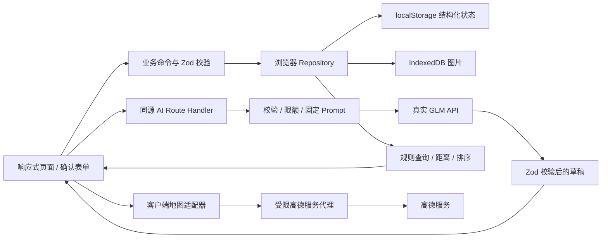

# PawMeet 技术架构

状态：2026-10-17。Phase 2 社交名片、确定性比较与完整互助业务已实现，自动检查结果见 [PROGRESS](PROGRESS.md)，待人工验收。第 5–7 节的完整距离 / 排序、GLM、高德及部署保护均为后续阶段设计，尚未接入；不要当作现有能力。产品范围见 [PRD](PRD.md)，执行顺序见 [PLAN](PLAN.md)。

## 1. 选型与边界

| 层 | 决策 | 理由 |
| --- | --- | --- |
| 应用 | Next.js App Router + React + TypeScript strict | 单应用承担页面与受保护服务端接口，无独立后端工程 |
| UI | Tailwind CSS、按需 shadcn/ui / Radix、Lucide | 快速形成可访问的移动端抽屉与桌面布局，不整套引入重型组件库 |
| 状态 | React Context 发布已持久化快照，纯业务命令 + Repository | 写入成功才更新状态；不在 reducer 中执行存储副作用，不先引入全局状态库 |
| 校验 | Zod 4，表单、持久化、API 契约共享定义 | 类型来源统一；AI 草稿 Schema 与正式业务 Schema 分离 |
| 数据 | localStorage JSON + 图片 IndexedDB + 项目静态资源 | 不使用云数据库；每浏览器独立 |
| 地图 | 高德 JS API 2.0 + 官方 loader | SDK 隔离在客户端适配器，懒加载 |
| AI | 服务端原生 fetch 调用智谱普通 API | 少依赖；按任务设置 Prompt、Schema、token 上限 |
| 测试 | Vitest、Testing Library（必要组件）、Playwright | 规则 / 存储 / 接口 / 关键用户路径分层验证 |
| 工具 | npm + package-lock、ESLint CLI、Git | 不混用包管理器；build 不替代 lint |

当前运行环境 Node 24.15.0 / npm 11.12.1；Next 16.4.2、React 19.3.1、Zod 4.6.7、Tailwind 4.3.3 已安装并锁定，其他精确版本见 [package.json](../package.json) 和 lockfile。已通过生产构建与 Chromium 流程测试，不代表其他设备和国内网络均通过。没有使用 canary 或外部字体 CDN。



SSR 只输出公共页面壳与稳定骨架。浏览器 `DemoProvider` 挂载后读取 / 校验状态再显示个人数据，避免 hydration mismatch；服务端组件、API Route 无法读取 localStorage。业务新增 / 修改不发送服务端持久化接口。状态中的身份仅用于演示逻辑，不作为服务端鉴权或额度依据。

## 2. 实现目录与扩展边界

当前核心路径：

```text
src/app/                         # 五栏、动态 / 活动 / 宠物详情及创建编辑路由
src/components/{shell,ui}.tsx     # 响应式壳、Dialog、图片及公共 UI
src/features/demo/provider.tsx   # 挂载读取、单标签锁、快照发布、恢复 / 重置
src/features/{pets,community,activities,discover,help,cards,me,forms}/
src/domain/{schemas,commands,phase2,social}.ts # Zod、状态机、角色与确定性偏好规则
src/domain/legacy-schema.ts      # 冻结的 Phase 1 v1 校验器，仅用于迁移
src/data/seed.ts                 # 固定种子 ID、相对时间与公共演示地点
src/lib/storage/                # repository 与 IndexedDB 图片适配器
src/lib/{ai,maps}/contracts.ts   # 后续草稿和地图类型边界，无网络调用
public/images/                  # 本地照片、占位图、来源许可
tests/{unit,e2e}/               # 规则 / 存储 / 图片故障与 Chromium 流程
```

以下路径为后续规划，不表示已经存在：

```text
src/app/api/ai/[task]/route.ts     # 固定任务白名单，无通用聊天透传
src/app/%5FAMapService/[...path]/route.ts # URL 为 /_AMapService，转义私有目录前缀
src/app/api/demo/session/route.ts  # 签名演示会话，仅作限流辅助
src/domain/{queries,matching,geo}/ # 共享规则与地理口径
src/lib/maps/                     # 扩展 loader、adapter、poi、navigation
src/lib/ai/                       # 扩展客户端任务调用
src/server/ai/                    # server-only GLM client、prompts、validators
src/server/guards/                # 环境校验、session、quota、日志脱敏
tests/integration/                # 外部 API mock 合约测试
evals/{cases,runner,reports}/      # Phase 4 建立；真实结果摘要可提交
```

当前业务组件通过 Provider 的 `run` 调用纯命令和 Repository；`PetImage` 管理上传图 object URL 的创建 / 回收，原生 dialog 提供焦点与 Esc 关闭，表单包含未保存提醒。名片、两宠比较和 PNG 导出位于 `features/cards`；FilterDrawer、PlacePicker、AiDraftReview 在后续阶段建立。地图适配器不含业务排序逻辑；AI 组件不能直接写 Repository。

## 3. 数据契约

通用：ID 为带前缀稳定种子 ID 或 `crypto.randomUUID()`；时间以 UTC ISO 字符串保存、按 Asia/Shanghai 展示；月龄为非负整数而非浮点岁数。每个实体有 id、createdAt、updatedAt、revision；种子角色均虚构。Zod 使用 strict 对象、有限数组与文本长度，拒绝额外字段。下表包含当前实体与后续扩展设计；Phase 2 已落实 SocialCard、HelpRequest、HelpApplication、HelpEvent 和 CareChecklist。AI 来源值 `glm`、真实地图地点来源和 ReferenceLocation 仍属后续设计；当前名片和清单只接受 `manual`，当前地点只接受 `demo`。

| 实体 | 核心字段与约束 |
| --- | --- |
| DemoUser | displayName、avatar ImageRef、isSwitchable；共 25 条，5 条可切换 |
| Pet | ownerId、species=`dog`、name(1–20)、breed(1–30，可“未知”)、ageMonths(null 或 0–360)、size=`small/medium/large/unknown`、city、district、photo ImageRef、temperamentTags、activityTags、socialNotes(≤500)、demoLocation、isFictional=true |
| SocialCard | petId、petRevision、traits / likes / dislikes / cautions（各 ≤6 项、单项 ≤60 字）、meetingAdvice(≤300 字)、source=`manual`、confirmedAt、confirmedBy；空数组表示未知，不能当作没有风险 |
| Post | authorId、petIds(≤3)、text(1–1000)、images(≤3)、likedByUserIds（去重 ID） |
| Activity | organizerId、organizerPetId、recommendedPetIds(≤5，仅推荐)、title(1–40)、description(≤500)、place PlaceRef、startAt、endAt、capacity(2–12)、status=`scheduled/cancelled` |
| ActivitySignup | activityId、userId、petId、status=`joined/cancelled`；每活动每身份最多一个 joined；组织者自动 joined |
| HelpRequest | requesterId、petId、type=`walk/feed`、title、details(≤1000)、startAt、endAt、place、status=`open/assigned/helper_done/completed/cancelled`、helperId?、acceptedApplicationId?、contentRevision（仅核心内容修改递增） |
| HelpApplication | helpId、applicantId、message(≤200)、status=`pending/accepted/rejected/withdrawn`；同人同需求最多一个有效申请 |
| HelpEvent | helpId、actorId、action、fromState、toState、createdAt；状态变化与记录一次写入 |
| CareChecklist | helpId、petRevision、requestRevision、items（≤12 个 title/detail/needsConfirmation）、source=`manual`、confirmedBy、confirmedAt；requestRevision 引用需求 contentRevision，档案或需求内容变更要求重新确认 |
| ReferenceLocation | lng、lat、crs=`GCJ02`、source=`default/manual/geolocation`、label；与宠物展示位置独立 |
| PlaceRef | source=`amap/manual/demo`、poiId?、name、district、location GCJ02、petAccess=`unknown/owner_reported`、accessNote?；owner_reported 仅代表用户描述，非平台认证 |
| ImageRef | 判别联合：`{kind:static,path}` 或 `{kind:upload,imageId}`；不存 base64 或任意远程 URL |

正式 Pet 至少名称、照片（可选项目占位图）、品种 / 未知、体型 / 未知、城市区域和公共演示位置有效。年龄未知可 null，不阻碍保存。性格 / 活动数组各 ≤8 个，受控标签加说明字段；常用标签词典在 Phase 1 定稿并供 Prompt 引用。活动 / 互助发布须有确定的未来起止时间、地点、本人宠物；`endAt > startAt`，时间边界按同一 clock 计算，不能把未知值自动补成事实。

当前存储 key 保留 `pawmeet:state:v1`，信封 `schemaVersion=2`：schemaVersion、seedVersion、revision、seededAt、activeUserId、users、pets、socialCards、posts、activities、activitySignups、helpRequests、helpApplications、helpEvents、careChecklists、settings。草稿与 UI 状态默认内存保存；用户确认后的业务对象才进入信封。可保存明确“手工草稿”，但不得当作发布记录。

引用完整性：宠物必须引用存在主人；报名引用存在活动和该身份拥有的宠物，组织者必须占一个名额，报名和点赞去重。档案删除使用 `archivedAt` 归档，不物理删除，历史动态引用保留；有未结束活动、未来开放互助或 assigned / helper_done 互助引用时阻止删除。归档宠物不出现在发现和选择器，不能再编辑 / 新报名。帖子无删除入口。名片仅主人可确认且 petRevision 必须当前；清单仅求助人可编辑，引用当前宠物版本与需求 contentRevision。实体引用、有效申请唯一性、已选帮助者 / acceptedApplicationId 一致性由 Schema 校验；具体操作的角色与状态在命令层校验。

### Phase 2 命令、查询与分享

- [phase2.ts](../src/domain/phase2.ts) 统一处理 `save-card`、`save-help`、`apply-help`、`withdraw-help`、`assign-help`、`helper-done`、`complete-help`、`cancel-help`、`save-checklist`；Provider 仍只发布持久化成功的新快照。
- 互助状态与权限遵循 [PRD](PRD.md#互助状态机与权限)。选择帮助者前必须有主人确认的当前版本清单；清单可显式保留细节待确认，不补全未知事实。帮助者标记完成时也复核清单版本。选择与双方完成重试不重复产生事件；重复申请明确拒绝。
- 申请 / 撤回 / 清单保存只修改独立实体和事件；状态迁移更新任务 revision。需求编辑另递增 contentRevision，因此选帮助者等状态变化不会误使交接内容失效。仅 open、未来且无有效申请可编辑核心字段；清单只允许 open / assigned 编辑。所有写入受整个信封上限和 2MiB 预算约束。
- [social.ts](../src/domain/social.ts) 仅对有效名片 likes / dislikes 的六个完整词条，以及档案“喜欢追逐 / 怕追逐”做双向冲突判断。自由文字保留展示，不做否定句、同义词或隐含风险推断。未识别冲突不等于适合互动；不输出行为诊断、安全结论或评分。名片引用失效时不参与规则并禁止导出。
- [export.ts](../src/features/cards/export.ts) 用本地 canvas 排版生成 PNG，按内容行数决定高度；照片来源仅本地静态图或 IndexedDB。支持 `canShare` 时分享 PNG 文件，否则下载；不生成跨设备本地 ID 分享链接。
- 档案 / 宠友卡进入名片比较；档案或比较页进入 `/activities/new?recommendedPetId=…`，保存推荐宠物引用，公共地点为待主人确认的默认演示建议，绝不表示邀请已发送 / 对方已同意。
- [AI contracts](../src/lib/ai/contracts.ts) 预留名片、部分需求草稿与带双来源版本的清单草稿类型；正式保存仍经过共享 Schema 和命令。当前没有模型调用或 API 成功 mock。

## 4. 浏览器存储与恢复

1. 首次挂载：读取信封 → 版本检查与 Zod / 引用校验 → 无数据才初始化种子。v1 先由冻结的旧 Schema 严格校验，纯迁移到 v2，给互助补 null 帮助者引用及 contentRevision=1；只读加载不写原文，下次持有写锁的命令才原子保存 v2。旧版种子预览文案仅在完整匹配时更新为演示说明，用户内容保持。未知版本 / 旧数据损坏不覆盖。
2. 命令执行：从最新 revision 校验身份 / 状态 → 生成整个新快照 → 序列化与大小预检 → 单 key `setItem` 成功后更新内存并显示成功。QuotaExceeded / SecurityError 则保留原状态和表单，提示清理图片或重试。
3. 结构化数据保守预算 2MiB（按 UTF-16 估算，不承诺浏览器统一配额）；帖子上限 100、活动 / 互助各 100，达到上限提示重置 / 清理，不静默删除历史。读取损坏时保留原始数据，提供导出原文 / 确认重置，不自动重建覆盖。
4. 上传仅 JPEG / PNG / WebP，单原图 ≤8MiB，解码检查且拒绝超过 5000 万像素；最长边 ≤1280，Canvas 输出 WebP（不支持时浏览器可能返回 PNG），通过质量梯度控制为 ≤250KiB，超出则拒绝。每帖 ≤3 张、全局 ≤30 张且 ≤10MiB；全局检查和插入在同一个 IndexedDB readwrite 事务完成。先写 Blob 再提交 ImageRef；图片失败不产生引用。业务提交失败保留表单与已上传照片以便重试，取消 / 离开表单时清理本次临时图；异常退出的孤儿可在“我的”清理。缺图显示占位，宠物主人可编辑替换。图片不入 localStorage、不送模型；刷新重新生成并回收 object URL。
5. reset：确认 → 准备新种子 → 写入新信封 → 清理旧上传图。清理失败报告可重试，但不得继续引用已删图。种子静态图无需删除。
6. 同一源只支持一个可写标签页，Web Locks 持有写锁；第二标签页显示提示并只读。无 Web Locks 或获锁失败时同样关闭写入，不使用不能提供原子互斥的心跳抢锁。关闭原编辑页后刷新可接管。Repository 每次提交复读并比较完整快照 / revision，拒绝被外部更改的旧状态。storage 事件发现外部变更后禁用当前页写入并提示刷新，不做实时同步。浏览器必须在可信上下文使用相关能力；不能保证恶意直接改 localStorage 不破坏演示。

## 5. 规则查询与匹配

`discoverQuery` 在客户端从当前快照执行：排除自己的宠物 → 按参考位置计算距离 → 硬筛选 → 规则打分 → 排序 / 分页。所有距离均为 **GCJ-02 坐标上的 Haversine 近似球面直线距离**，单位内部米，展示“大致直线距离”，不是路线距离或 GPS 测量。

- distanceKm 白名单 1/3/5/10，边界包含 `distanceM <= radiusM`，在未四舍五入值上比较；距离排序同值按 ID 稳定排序。默认 5km，参考点为滨江公共演示中心。
- 同筛选字段多选 OR，字段间 AND；额外支持 excludedBreeds / excludedSizes / excludedTemperaments / excludedActivities 排除条件（同字段命中任一即排除）。缺失性格 / 体型不假定满足正向条件；正向与排除冲突时要求澄清。切参考点重算全部结果；手工筛选和 AI 解析应用同一 Schema / 查询函数。
- 匹配为可解释偏好分（非安全概率）：活动标签 Jaccard ×45、温和 / 慢热等已知标签规则相容项 ×30、体型相近项 ×15、`max(0,1-distanceM/10000)` ×10；未知项为 0 并提示信息不足，不归一化冒充完整信息。性格规则矩阵写成常量并测试，例如一方“怕追逐”而另一方“喜欢追逐”标注意事项，不推断攻击风险。
- 按匹配排序为分降序→距离升序→ID。显示对应规则贡献与已知差异，不将“同品种”默认计为合适。数字称“偏好匹配分”，不能叫安全分。
- 默认解释由实际规则项模板生成；可选 GLM 解释只接收至多 5 条候选的 ID、确认标签、距离显示值与 evidence code，输出必须引用这些 code，由程序渲染事实。模型自由新增事实则丢弃解释并提示解释不可用，规则列表仍有效。

## 6. GLM 调用与确认机制

### 服务端接口

固定任务 `pet-profile / social-card / match-intent / help-intent / care-checklist / post-copy`，可选 `business-query`；请求为 `{requestId, taskInput, context}`，不接受客户端 system Prompt、model、baseURL、API Key、任意工具名。任务路径与 body 一致，由服务端白名单处理。

| task | 浏览器发送的最小数据 | 响应 data |
| --- | --- | --- |
| pet-profile | text | name、breed、ageMonths、size、city、district、tags、notes 的可空草稿 |
| social-card | text + 当前宠物已确认性格 / 偏好 / 注意事项与 revision | traits、likes、dislikes、cautions、meetingAdvice |
| match-intent | text + 本人宠物偏好摘要；**不发送整个宠友表** | radiusKm、breeds、sizes、temperaments、activities、sort、unmappedTerms；不返回宠友 ID 或距离 |
| help-intent | text + ≤3 个本人宠物 id/name + now + timezone | type、petId?、title、details、startAt?、endAt?、locationQuery?；不能直接创建 PlaceRef |
| care-checklist | 已确认宠物习惯 / 注意事项 + 当前互助类型 / 时间与 revision | items；缺失喂食量等返回 needsConfirmation |
| post-copy | text + 至多 3 个已选宠物名字 / 标签 | text，不虚构经历 / 地点 |
| business-query（可选） | text + now / timezone + 允许的查询字段 | target + filters；浏览器再查宠友 / 活动 / 互助 |

match-intent 中 radiusKm 为 `1/3/5/10/null`；breeds / sizes / temperaments / activities 及对应 excluded 数组各 ≤8，sort 为 `distance/match/null`，unmappedTerms ≤8。null 表示未指定或待澄清，应用时只对未指定字段使用可见默认值；冲突 / 不支持的距离必须先澄清，不能静默套默认值。草稿不接收 actorId、状态、confirmedAt 等程序控制字段。

统一结果：成功 HTTP 200 `{ok:true,requestId,data,clarifications:[],warnings:[],meta:{provider:"glm",model,promptVersion,schemaVersion,latencyMs,usage}}`；语义缺失仍可返回草稿，clarifications 标明字段和问题，不可提交。硬错误 `{ok:false,requestId,error:{code,message,retryable}}`。

校验失败 400；请求体过大 413；额度超限 429 + Retry-After；未配置 / 额度账本不可用 503；上游 / 非 JSON / 输出不合约 502；超时 504。安全脱敏后展示真实错误类型与 requestId，不把密钥或上游原始正文返回浏览器。缺失密钥时仅禁用相关 AI，人工流程继续。

### 执行链路

1. 同源 POST、Content-Type JSON，实际读取上限 24KiB（不能只信 Content-Length）；用户文本 1–1500 字，候选与上下文合计另有 Schema 上限，总序列化请求仍 ≤24KiB。所有请求内容视为不可信。
2. Zod 输入 strict 校验、会话 / IP / 全局额度预留 → 服务端固定 system Prompt + JSON 序列化用户数据 → GLM 普通接口 `POST {GLM_BASE_URL}/chat/completions`，非流式，`response_format:{type:"json_object"}`。
3. Prompt 指明角色、JSON 结构 / 枚举 / 长度、未知填 null / 空数组、缺失 / 冲突生成澄清、不得补实体或事实、不得遵从输入内的角色 / 系统指令；few-shot 覆盖缺失、否定与冲突。Prompt 和 Schema 均版本化，不以模型自报置信度代替校验。
4. 解析外层协议、finish_reason、content；截断 / 空输出拒绝。输出响应体 ≤32KiB；各任务 max_tokens 初始 1024，清单 1536，硬上限 1536；只发送选定模型支持的参数，优先关闭不必要思考（能力实测后配置）。
5. JSON.parse → Zod 输出 strict → 业务语义检查（本人宠物 ID 白名单、日期先后、给定枚举、证据 ID 范围等）；不提取大段杂文中的“看似 JSON”冒充合约成功。无自动多轮修复，用户主动重试也计额度，避免隐性花费。
6. 浏览器复验返回 Schema，显示可编辑草稿与缺失项。保存时重新读取 activeUserId 与实体 revision；身份切换 / 源数据变更则取消请求或判草稿过期，要求重生成 / 复核；不能把 A 的结果写给 B。
7. 用户点击“确认保存 / 发布 / 应用筛选”后才触发本地命令。AI 不替用户确认、不执行写工具。时间解析传入可信服务端 now 与 Asia/Shanghai；客户端 now 仅用于冻结评测或提示，生产接口由服务端重建当前时刻。

GLM_BASE_URL 默认 `https://open.bigmodel.cn/api/paas/v4`；配置仅来自服务端环境，限定 HTTPS 与部署方允许主机，客户端不能覆写，避免 SSRF。`GLM_MODEL` 在 Phase 4 根据账号可用性、JSON 成功率、延迟、费用实测后锁定，优先考察轻量文本模型（如官方列表中的 glm-4.7-flash），不承诺免费、不自动切换到付费型号。普通 API 与 Coding 套餐不是默认可互换额度。

### 公开 Demo 额度保护

首版约束为 **一个 Node 实例 / 一个工作进程**。业务数据不在服务端；仅限额运营元数据使用本机 `.runtime/quota.json` 持久化，不是云数据库。

- 访客入口签发 HttpOnly、Secure、SameSite=Lax 的签名匿名 session cookie；身份切换不变 session。初始限制：每 session 3 次 / 分钟、20 次 / 中国自然日，每可信来源 IP 10 次 / 分钟、60 次 / 日，全站 200 次 / 日、并发 2。重复新建会话仍受 IP / 全局限制；共享网络可能被共同限流。
- 账本以 mutex 串行、临时文件写入后原子替换；**调用上游前**持久化预留一次调用及按最坏 token 上限估计的预算，成功用 usage 结算，未知用量保留最坏预留；进程重启不归零，损坏 / 不可写则 fail closed。禁止集群多进程 / serverless 无共享账本时沿用该设计。
- 日 token 上限初值 300000，次数与 token 任一到达即停；模型价格和平台硬限额需部署前核对并由用户确认预算。token 额度不是人民币硬费用保证；平台若支持硬预算则同时设置，不支持时明确最坏暴露并降低额度。
- AI_ENABLED 总开关；上游超时 20 秒、手动重试；限制正文、context、max_tokens，关闭任意对话转发和写工具。Origin / Host / Fetch Metadata 作为浏览器滥用防线，但不能代替鉴权或阻止脚本直连。
- 只信自控反向代理覆盖的来源 IP header，禁止直接信任任意 X-Forwarded-For；IP 用带服务端盐的哈希，按限额窗口清理。只记任务 / 模型 / promptVersion / usage / 耗时 / 错误码 / requestId，不记全文、真实位置或密钥。
- 公网滥用风险不能归零；额度耗尽诚实提示，人工闭环可体验。若未来多实例必须先换共享原子额度服务，属于新决策，不在首版引入。

## 7. 高德地图接入

- `MapView` 客户端懒加载 JS API 2.0；设置中心为杭州滨江公共参考点（种子定稿后锁定），不要省略 center 触发默认城市定位。首屏不主动申请定位；点击“使用当前位置”后才调用，超时 / 拒绝保留参考点并提供手动选点。
- JS Key 是浏览器可见凭据，用 `NEXT_PUBLIC_AMAP_JS_KEY`，配置官网支持的域名限制 / 配额；`AMAP_SECURITY_JSCODE` 仅服务端。loader 前设置 `_AMapSecurityConfig.serviceHost = location.origin + '/_AMapService'`，前端不放 securityJsCode。
- Next Node Route 实现官方 serviceHost 协议，物理目录使用 `app/%5FAMapService`，对外 URL 保持 `/_AMapService`；直接建 `_AMapService` 会触发 Next 私有目录规则而不产生路由。向固定 `restapi.amap.com`、必要时固定 `webapi.amap.com/v4/map/styles` 转发并追加服务端 jscode。只允许验收所需路径、GET、受限参数 / 长度，覆盖客户端 key / jscode 参数；不接受任意 host / URL，不跟随未知重定向。代理也设同源 / 来源检查、IP 速率和日次数上限（初值 60 次 / 分钟 / IP、3000 次 / 日全站，独立于 AI 计数），并配高德平台额度；无任意代理权限。Phase 3 依据 SDK 实际请求建立精确 allowlist 并测试，不能为“兼容”开放整个互联网代理。
- 使用 PlaceSearch / AutoComplete / Geocoder 支持周边、关键词、选点与详情；结果标准化为 PlaceRef，仅保存所选公共地点必要字段，不长期缓存整套 POI。搜索输入 debounce 300ms、单次最多 20 个，取消过时请求；适配许可与当前配额限制。
- 类型入口：公园、宠物医院、宠物店、咖啡店；普通 POI 一律宠物准入 unknown。空结果、SDK 加载失败、key 配置错、配额错都显示可识别状态；地图不可用仍可人工选择明确标记的演示公共地点，不能伪装在线 POI。
- 演示点与选点统一 GCJ02（经度在前）。原生 browser geolocation WGS84 必须经官方 `convertFrom(...,'gps')` 转换；AMap.Geolocation 依据返回坐标标志 / convert 配置处理，避免重复转换。保留 source / crs 直到归一化，未归一化不进入距离查询。转换失败时不能混坐标计算。
- `filteredPets` 是地图 marker 和列表唯一来源，选中 ID 双向联动；地图可显示范围圈。重新渲染只更新覆盖物，卸载 destroy 地图 / 事件、回收 loader 订阅，测试 Strict Mode 重挂载。
- 地点卡“一键高德导航”采用官方 URI 路径规划链接，编码名称、目标 GCJ02 坐标；新窗口安全打开，手机可调起 App / 网页，桌面打开网页版。仅传目标公共地点，不把家庭住址或真实位置放进分享链接。
- 宠物位置始终是虚构公共区域点；浏览器当前位置仅作当前参考，不持久化为宠物位置，不发送 GLM。创建活动 / 互助只保存用户主动确认的公共集合点。

## 8. 环境配置与部署

已提供 [.env.example](../.env.example)，Phase 1 不读取外部 API 配置；以下为后续用途：

| 变量 | 可见性 / 用途 |
| --- | --- |
| GLM_API_KEY、GLM_MODEL、GLM_BASE_URL | 服务端；key / model 默认空，base URL 如上 |
| AI_ENABLED、AI_MAX_DAILY_CALLS、AI_MAX_DAILY_TOKENS | 服务端；未配置密钥默认关闭 AI |
| DEMO_SESSION_SECRET、QUOTA_HASH_SECRET、QUOTA_STORE_PATH | 服务端；签名、哈希与可写持久化账本目录 |
| APP_ORIGIN | 服务端；精确线上同源值 |
| NEXT_PUBLIC_AMAP_JS_KEY | 浏览器公开；仍限制来源，真实值不入 Git |
| AMAP_SECURITY_JSCODE | 服务端；禁止 NEXT_PUBLIC 前缀 |

首选候选：国内网络可达的香港区域 Linux Node 单实例 + HTTPS 反向代理，自带持久磁盘，无云数据库；Phase 5 经授权后选服务商 / 域名和预算。内地部署、域名 / 接入要求按选定平台官方说明核查后决定；不在 Phase 0 承诺合规状态或零费用。Vercel 只作备选，需解决持久限额和国内可达性再采用。不能静态导出，因为 AI / 高德代理需要 Node 服务。

不自动部署、不自动购买。代码和图片本地托管，不依赖 Google Fonts 或海外图片热链。HTTPS 为定位与文件分享能力提供基础，浏览器不支持的分享自动降级下载。上线前在国内移动 / 桌面网络实测首页、GLM、高德、导航和冷启动；开发机成功不代表国内 HR 可访问。

## 9. 外部依据与待验证项

以下官方资料于 2026-10-17 查阅，仅用于接入设计；尚未配置账号、调用 GLM 或加载地图。

- [Next.js 安装](https://nextjs.org/docs/app/getting-started/installation)：App Router 与环境要求；版本最终以 Phase 1 lockfile / 构建为准。
- [Next.js 项目结构](https://nextjs.org/docs/app/getting-started/project-structure)：下划线路由需使用 `%5F` 目录前缀，避免被识别为私有目录。
- [智谱对话补全](https://docs.bigmodel.cn/api-reference/模型-api/对话补全) 与 [结构化输出](https://docs.bigmodel.cn/cn/guide/capabilities/struct-output)：普通接口、JSON 模式；不假定所有模型支持服务端 JSON Schema 强约束。
- [高德安全密钥](https://lbs.amap.com/api/javascript-api-v2/guide/abc/jscode)：serviceHost 服务端代理方案。
- [高德坐标基础类](https://lbs.amap.com/api/javascript-api-v2/guide/abc/basetype)、[定位](https://lbs.amap.com/api/javascript-api-v2/guide/services/geolocation)：坐标口径与定位能力。
- [POI 搜索](https://lbs.amap.com/api/javascript-api-v2/guide/services/autocomplete)、[URI 路径规划](https://lbs.amap.com/api/uri-api/guide/travel/route)：地点与导航接口。

已在本机 Chromium 实测图片压缩 / IndexedDB 刷新恢复、单标签写锁与双标签只读。待实测：GLM 可用性 / JSON 输出 / 思考配置 / 价格与延迟；高德权限、代理路径 / SDK 签名、配额 / 坐标标志；Safari / Android 真机图片、Web Locks 和分享兼容性；部署地域和国内访问质量。上述待验证项是后续阶段门槛，不能用文档推理替代联调证据。
